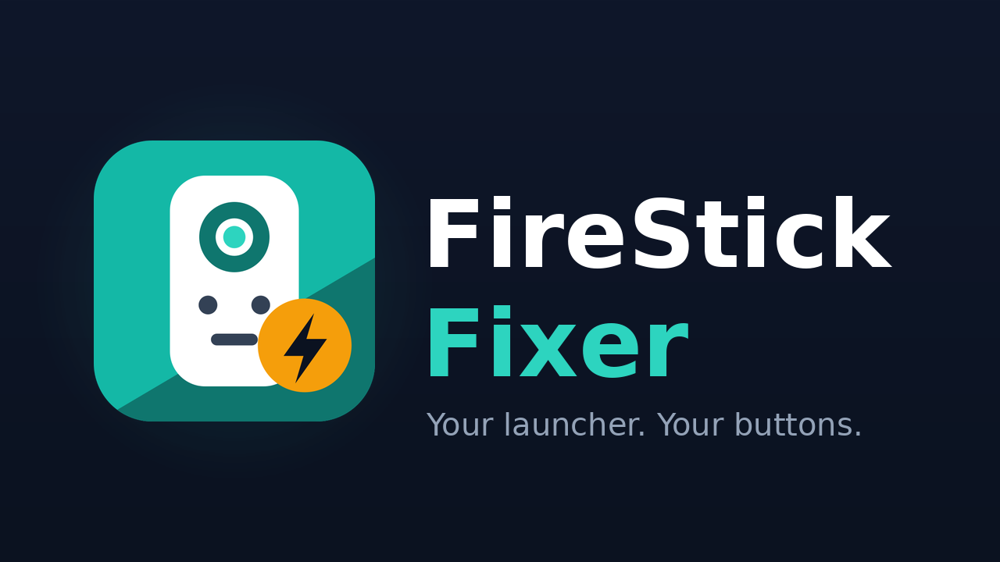
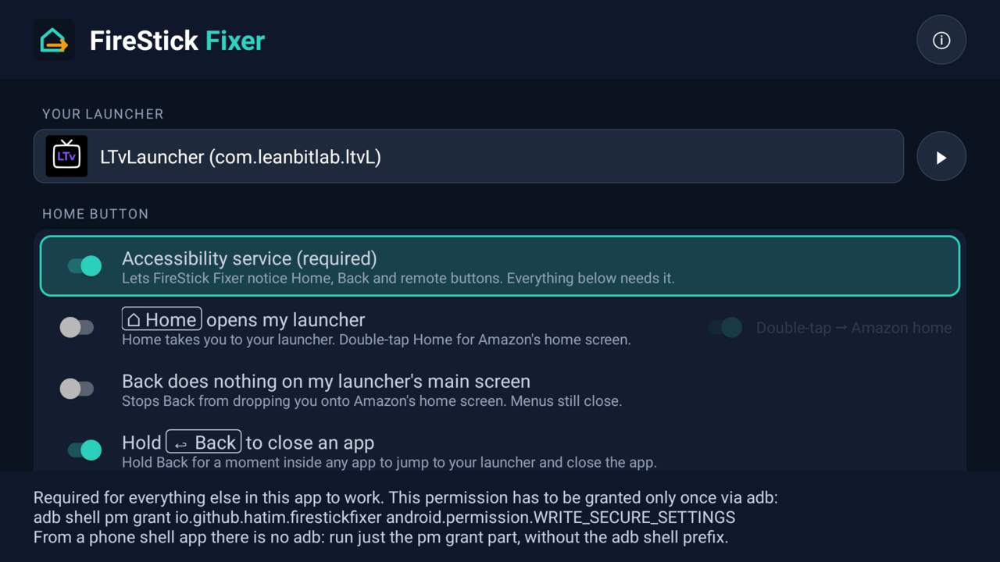

<p align="center">
  
</p>

# FireStick Fixer

**FireStick Fixer** makes a Fire TV Stick behave like *your* device:

- <kbd>⌂ Home</kbd> opens the launcher you chose (LtvLauncher, Projectivy, FLauncher, …)
  instead of Amazon's home screen, with no Amazon flash in between.
- The remote's app buttons (YouTube, Prime Video, Netflix, ⊞ Apps, Live TV, …) can be
  remapped to any app. For example, the YouTube button can open TizenTube.
- Any app you pick opens automatically at start-up and on wake.
- Hold the Alexa button **inside an app** and speak: the app you're in searches for what you
  said, instead of Alexa's own results page.

It is a fork of [Home on Fire](https://github.com/toolicious/home-on-fire) by toolicious
(GPLv3), reworked for current Fire OS 8 builds. See [What changed](#what-changed-from-home-on-fire).



Package: `io.github.hatim.firestickfixer`. Tested on a Fire TV Stick (AFTMA08C15) running
**Fire OS 8.1.8.5** (Android 11).

---

## How to use it

| On the remote | What happens |
|---|---|
| <kbd>⌂ Home</kbd> (anywhere) | Opens your launcher |
| <kbd>⌂ Home</kbd> <kbd>⌂ Home</kbd> (double-tap) | Stays on the Amazon home screen |
| <kbd>⌂ Home</kbd> once more | Back to your launcher |
| <kbd>↩ Back</kbd> on your launcher's main screen | Nothing. It no longer drops you onto Amazon home. Back inside the launcher's own menus still works |
| <kbd>↩ Back</kbd> out of an app | Your launcher |
| Hold <kbd>⌂ Home</kbd> | Amazon's normal long-press panel (profiles, sleep, mirroring), untouched |
| Hold <kbd>☰ Menu</kbd> (anywhere) | The quick menu, styled like Amazon's own panel: VPN on/off with its status, Amazon home, Fixer settings. Choose which items appear in Settings → Quick menu |
| A remapped app button | The app you chose |
| Hold Alexa inside an app and speak | That app searches for what you said (Back during the countdown keeps Alexa's results) |
| Hold <kbd>↩ Back</kbd> ~1 s inside an app | Straight to your launcher; the app is closed |
| Hold Alexa on your launcher or Amazon home | Alexa's own results, as usual |

---

## Install (one time, from a computer with `adb`)

1. On the Fire TV: **Settings → My Fire TV → Developer Options → ADB debugging: On**.
   (No Developer Options? **Settings → My Fire TV → About**, click the device name 7 times.)
2. From the computer:

```sh
adb connect <fire-tv-ip>:5555
adb install firestick-fixer.apk

# Lets the in-app switch turn the accessibility service on
# (Fire OS hides the Accessibility settings page):
adb shell pm grant io.github.hatim.firestickfixer android.permission.WRITE_SECURE_SETTINGS

# Recommended: precise detection of Home presses and remote app buttons (read-only):
adb shell pm grant io.github.hatim.firestickfixer android.permission.READ_LOGS
```

3. Open **FireStick Fixer** on the TV, switch on **Accessibility service**, and pick
   **Your launcher**.

Both grants survive reboots and updates. You only need `adb` again if you uninstall the app.

### Or: install on the TV and follow the checklist

In **Downloader** on the TV, open this address (it always gets the newest release):

```
https://github.com/Hornet34/firestick-fixer/releases/latest/download/firestick-fixer.apk
```

Then open FireStick Fixer and follow the checklist at the top of its screen. It shows the TV's address and the exact commands to type on a computer, required
first, then the optional boosts. Each one ticks off by itself once it's done, and the service
switches itself on after the required one.

### Optional: Fast actions (instant app closing)

With Fast actions, holding <kbd>↩ Back</kbd> force-stops the app (it starts fresh next time),
and the quick menu gets **Free up memory**. FireStick Fixer does this through the stick's own
`adb` (wireless debugging, on `127.0.0.1` only, a tenth of a second per action), so it needs
one more step from the computer, once:

```sh
tools/setup-adb.sh <fire-tv-ip>
# or, without cloning the repo:
curl -sL https://raw.githubusercontent.com/Hornet34/firestick-fixer/main/tools/setup-adb.sh | bash -s <fire-tv-ip>
```

The script does the two grants above too. Press **Allow** on the TV when it asks ("Allow USB
debugging?", and on a new Wi-Fi "Allow wireless debugging on this network?"). The app makes its
own key; the private key never leaves the TV. Only a fixed list of commands exists (force-stop,
and read-only checks); system and Amazon apps, your launcher, keyboard and connected VPN app
are never stopped. Without Fast actions everything works as before. Details:
[docs/DECISIONS.md](docs/DECISIONS.md) D34–D42.

### Why `READ_LOGS`?

Fire OS never lets an app see the <kbd>⌂ Home</kbd> key or the remote's app buttons. They are
consumed by Amazon's key policy before any accessibility service. The **system activity
log** does record them, as one line per press:

```
START u0 {act=android.intent.action.MAIN cat=[android.intent.category.HOME] ...} from uid 0
START u0 {... com.amazon.venezia/.pdi.AppLaunchActivity ... clickStreamReftag=r_btn_app_33 ...} from uid 1000
```

With `READ_LOGS` the app follows just those `ActivityTaskManager` lines. That gives it:

- **Instant Home**: the screen is covered and your launcher started ~40 ms after the
  press, before Amazon home has painted.
- **Exact double-tap**: two Home presses counted by the system itself, not guessed from
  window events.
- **Button-only remapping**: the YouTube button opens TizenTube, but opening YouTube from
  your launcher still opens YouTube.

Without the grant everything still works, with slower window-based detection. Amazon home
can flash briefly on <kbd>⌂ Home</kbd>, and remapped apps are told apart from manual opens
by whether you just pressed OK. The **Precise button detection** row in the app shows
which mode is active. Nothing is ever sent anywhere: the app has no internet permission.

---

## Remapping a remote button

**Remap remote buttons** → **Custom** → pick an app for a row → press OK on the button field
and press the remote button you want to remap. Nothing else is needed: no `adb`, no
key codes.

- **App buttons** (YouTube, Netflix, Prime Video, ⊞ Apps, Live TV): Amazon opens that
  button's app itself. FireStick Fixer opens your app right after, hides the original
  behind a black cover, and stops it in the background. Back from your app goes to your
  launcher, never to the original app.
- **Key-code buttons** (colour, number, media keys on some remotes) are swallowed outright
  and open your app instantly.

---

## Alexa voice search in the app you're in

Alexa only hands voice searches to apps built with Amazon's Alexa integration (Netflix,
Prime Video, …). For any other app it opens its own search page. FireStick Fixer reads
the spoken words from that page and runs the search in the app you were in:

Every app goes through the same steps; there is no per-app code:

1. a YouTube search link (YouTube, TizenTube, SmartTube, other YouTube clients);
2. Android's standard search request (`ACTION_SEARCH`);
3. a search box already on screen: the words are typed in and submitted;
4. an element labelled "Search": clicked, then typed into;
5. a side menu of bare icons (e.g. Nuvio): its items are tried from the top until a
   search box appears. The item that worked is remembered per app and tried first
   next time.

Alexa's results page is closed before the hand-off, so Back from the app never lands on
it. A waiting screen covers the app while it opens its search (Back cancels). If no
search is found, a short message says so.

Alexa commands and questions (weather, volume, smart home) never reach that search page
and are not affected. Speak from your launcher or Amazon home to get Alexa's own results,
or switch the feature off in the app.

The app's config screen shows a **Finish setting up** banner until both one-time `adb`
grants above are in place, with the exact commands.

---

## Known limits

- **Amazon's home screen content** (sponsored rows, ads, autoplay) cannot be changed by any
  app without root. You can reduce it in Fire OS itself:
  **Settings → Preferences → Featured Content** (turn off video and audio autoplay), and
  **Settings → Preferences → Privacy Settings** (turn off interest-based ads and usage data).
  Or keep a clean launcher as your home, which is what this app is for.
- **Cropped icons of sideloaded apps on Amazon's home**: Amazon shows each app's TV
  banner, and many sideloaded apps don't ship one. That's the other app's artwork, not
  something this app can change. Third-party launchers such as LtvLauncher handle it.
- **App buttons always start their own app first**: the system starts it before any app
  can react. FireStick Fixer covers it, but a cold start can flash for a frame.
- **Vega OS** devices (new Fire TV Sticks since late 2025) don't run Android apps.

---

## What changed from Home on Fire

- Double-press escape sticks: Amazon home's follow-up focus events no longer bounce you
  back to the launcher. A single Home press brings the launcher back.
- Long-press escape removed by default, so the long-press panel keeps its tiles.
- Precise Home and app-button detection via the system activity log (optional `READ_LOGS`).
- Instant Home: screen cover plus launch on the Home press itself, with no Amazon flash.
- Remapped app buttons fire only for the button, not when you open that app yourself.
- Fixed the Back loop between a remapped app and the original (e.g. TizenTube ↔ YouTube).
- Back on the launcher's main screen does nothing; Back in its menus still works.
- Choose any app to open at start-up, not just the launcher.
- Quick menu on a held Menu button, with a VPN switch that works with any installed VPN app
  (it opens the VPN app behind a progress screen, presses connect or disconnect, and returns).
- New interface, logo and banner; removed the Menu long-press, long-press escape and
  Fire OS 7 loading-screen options from the UI.

---

## More settings

- **Apps that keep Alexa's results:** voice search is not handed to these apps.
- **Hold ↩ Back to close an app:** hold Back ~1 s in an app to jump to your launcher and
  close the app.
- **Fire OS updates:** shows whether Amazon's updater is active and how to hold updates
  back (router/DNS or adb). The app re-checks itself after any Fire OS update.

## Documentation and testing

- [docs/ARCHITECTURE.md](docs/ARCHITECTURE.md): how each feature works.
- [docs/DECISIONS.md](docs/DECISIONS.md): every design decision with its evidence.
- [docs/TESTING.md](docs/TESTING.md): automated test (`tools/device-test.sh`, no remote
  needed) and the manual checklist.

---

## Building from source

No Gradle: `aapt2` + `javac` + `d8`, driven by [`build.sh`](build.sh) (Linux/macOS) or
`build.ps1` (Windows, upstream).

```sh
# Needs a JDK (17+), Android build-tools 34 and platform 34, e.g. via sdkmanager:
sdkmanager "build-tools;34.0.0" "platforms;android-34"

# One-time signing key, kept outside the repo:
keytool -genkeypair -keystore ~/.android-signing/firestick-fixer.keystore \
  -storetype PKCS12 -alias firestick-fixer -keyalg RSA -keysize 3072 -validity 20000
echo "storePass=<your password>" > ~/.android-signing/firestick-fixer.properties

./build.sh            # → firestick-fixer.apk
./build.sh --install  # build and adb install -r
```

Updates must be signed with the same key, so back up `~/.android-signing/`.

---

## License and credits

[GPLv3-or-later](LICENSE). Based on [Home on Fire](https://github.com/toolicious/home-on-fire)
by toolicious; modified by the FireStick Fixer contributors.
